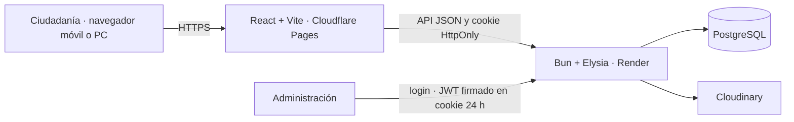

# Arquitectura de RadioHuasteca

## Capas

- **Interfaz:** React 19, Vite 8 y Tailwind CSS v4; navegación adaptada a PC y móvil.
- **API:** Bun y Elysia. Las operaciones administrativas verifican la sesión firmada y vuelven a consultar al usuario activo en PostgreSQL.
- **Datos:** PostgreSQL; `backend/schema.sql` crea usuarios, auditoría, avisos, boletines, trámites, cápsulas, buzón y envíos de medios.
- **Archivos:** Cloudinary. Las imágenes usan `f_auto,q_auto,c_limit,w_400`; los audios privados del buzón usan recursos autenticados.

La sesión se firma con HMAC SHA-256 en formato JWT, se entrega en cookie `HttpOnly` y vence a las 24 horas. `SESSION_SECRET` debe tener al menos 32 caracteres. El navegador nunca recibe el secreto.
